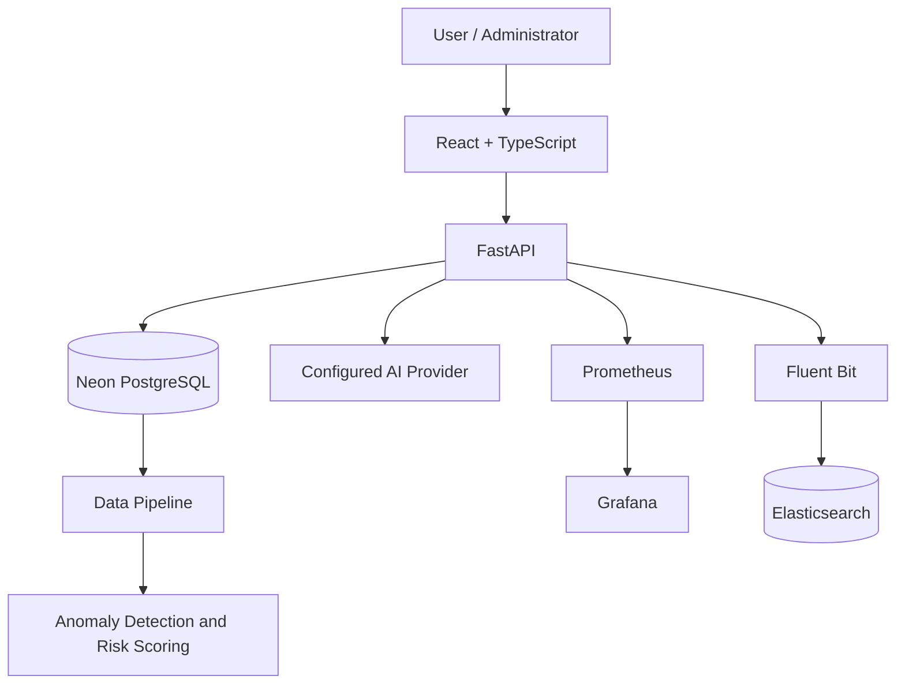

# KBR — Knights of Bizertin Rise

**A full-stack esports and community platform featuring administration tools, event and member management, an AI assistant, and machine-learning risk monitoring.**

[](https://www.python.org/)
[](https://fastapi.tiangolo.com/)
[](https://react.dev/)
[](https://www.typescriptlang.org/)
[](https://www.postgresql.org/)
[](https://www.docker.com/)

**Live application:** https://kbr-five.vercel.app  
**Backend health:** https://kbr-backend.onrender.com/health  
**Repository:** https://github.com/Ghaith-Saidani/KBR

---

## Overview

Knights of Bizertin Rise (KBR) is a web platform developed to support esports and community activities in Bizerte, Tunisia.

The project combines a React and TypeScript frontend, a Python/FastAPI backend, and PostgreSQL persistence. It also integrates AI-assisted functionality, a data-processing pipeline, machine-learning risk analysis, and operational monitoring.

KBR brings together full-stack development, database engineering, API integration, containerization, deployment, and data/AI engineering in one project.

## Features

### Web application

- Authentication and account functionality.
- Administrative dashboard and management tools.
- Member management.
- Event management.
- Activities and community content.
- News and updates.
- Contact submissions.
- Notifications.
- Integrated AI assistant.

### Data, AI, and monitoring

- Data extraction and processing pipeline.
- Configurable AI provider architecture for Gemini and Groq.
- Machine-learning anomaly detection and risk scoring.
- HTTP and business-activity observations.
- Temporal incident analysis.
- Risk-scoring reports for investigation.
- Prometheus metrics and Grafana dashboards.
- Centralized log collection with Fluent Bit and Elasticsearch.
- MLflow support for experiment and model-management workflows.

Risk scores and anomaly flags are investigation indicators, not proof of malicious activity.

## Live deployment

| Component | Technology | URL |
|---|---|---|
| Frontend | Vercel | [Open application](https://kbr-five.vercel.app) |
| Backend API | Render | [Open backend](https://kbr-backend.onrender.com) |
| Health endpoint | FastAPI | [Check health](https://kbr-backend.onrender.com/health) |
| Production database | Neon PostgreSQL | Managed database |

The project owner has tested the deployed application features.

## Architecture



### Main components

- **Frontend:** React, TypeScript, Vite, React Router, TanStack React Query.
- **Backend:** Python 3.12, FastAPI, Pydantic, and application service modules.
- **Database:** PostgreSQL, SQLAlchemy, and Alembic.
- **AI:** Configurable conversational AI provider integrations.
- **Data and ML:** Data processing, anomaly detection, risk scoring, and MLflow workflows.
- **Observability:** Prometheus, Grafana, Fluent Bit, and Elasticsearch.
- **Deployment:** Vercel, Render, and Neon PostgreSQL.
- **Local infrastructure:** Docker and Docker Compose.

## Technology stack

| Area | Technologies |
|---|---|
| Frontend | React, TypeScript, Vite |
| API and backend | Python 3.12, FastAPI, Pydantic |
| Database | PostgreSQL, SQLAlchemy, Alembic |
| AI integration | Gemini, Groq |
| Data and ML | Python, anomaly detection, risk scoring, MLflow |
| Logging and search | Fluent Bit, Elasticsearch |
| Monitoring | Prometheus, Grafana |
| Containers | Docker, Docker Compose |
| Deployment | Vercel, Render, Neon |
| Version control | Git, GitHub |

## Repository structure

```text
KBR/
├── backend/
│   ├── app/
│   │   ├── ai/
│   │   ├── api/
│   │   ├── core/
│   │   ├── middleware/
│   │   ├── models/
│   │   ├── schemas/
│   │   └── services/
│   ├── tests/
│   └── Dockerfile
├── frontend/
│   └── src/
│       ├── app/
│       ├── components/
│       ├── features/
│       ├── pages/
│       ├── services/
│       ├── stores/
│       └── test/
├── data/
│   ├── models/
│   └── reports/
├── monitoring/
├── docker-compose.yml
├── alembic.ini
├── .env.example
└── README.md
```

This is a high-level overview; consult the repository for the exact current layout.

## Run locally

### Prerequisites

- Git
- Python 3.12
- Node.js and npm
- Docker Desktop with Docker Compose
- Required environment variables and provider credentials

### 1. Clone the repository

```bash
git clone https://github.com/Ghaith-Saidani/KBR.git
cd KBR
```

### 2. Configure environment variables

Use `.env.example` and the application settings as the source of truth for required variables.

**PowerShell:**

```powershell
Copy-Item .env.example .env
```

**Linux/macOS:**

```bash
cp .env.example .env
```

Fill in the values required by your local configuration. Never commit `.env` files, API keys, database passwords, or other secrets.

### 3. Start the infrastructure

```bash
docker compose config --quiet
docker compose up -d --build
docker compose ps
```

Inspect logs when needed:

```bash
docker compose logs --tail=100 backend
docker compose logs --tail=100 frontend
docker compose logs --tail=100 postgres
```

### 4. Local service endpoints

When the corresponding services are enabled and running:

| Service | URL |
|---|---|
| Frontend | http://localhost:8080 |
| Backend API | http://localhost:8000 |
| Interactive API documentation | http://localhost:8000/docs |
| Backend health | http://localhost:8000/health |
| Prometheus metrics | http://localhost:8000/metrics |
| Prometheus UI | http://localhost:9090 |
| Grafana | http://localhost:3000 |
| Elasticsearch | http://localhost:9200 |
| MLflow UI | http://localhost:5000 |

Some services require additional environment configuration. Consult `docker-compose.yml` and the monitoring configuration.

### 5. Run the backend or frontend separately

**Backend — Windows PowerShell:**

```powershell
python -m venv .venv
.\.venv\Scripts\Activate.ps1
python -m pip install -r backend\requirements.txt
```

**Frontend:**

```bash
cd frontend
npm install
npm run dev
```

Use the project's configured startup commands and environment variables for your environment.

### 6. Stop local services

```bash
docker compose down
```

This stops containers while preserving named volumes. Avoid `docker compose down -v` unless you intentionally want to delete persisted local data.

## Data and machine learning

The data and ML components complement the main application:

1. Application data is extracted from the configured data source.
2. Processing stages prepare observations for analysis.
3. Anomaly-detection models and risk scoring produce indicators and reports.
4. Results can be reviewed through the project's reporting and monitoring functionality.

Generated reports represent the data available when they were created. They should not be assumed to refresh continuously unless a scheduled or manually executed pipeline is configured.

## Monitoring and observability

The local monitoring stack includes:

- **Prometheus:** backend metrics collection.
- **Grafana:** dashboards and visualization.
- **Fluent Bit:** log collection and forwarding.
- **Elasticsearch:** log indexing and search.

These tools help investigate request behavior, service errors, latency, and application logs. Configuration files are available under `monitoring/`.

## Testing

The repository includes backend tests, frontend test infrastructure, and automated quality checks.

**Backend tests:**

```bash
python -m pytest backend/tests
```

**Frontend checks:**

```bash
cd frontend
npm run build
npm run lint
```

Check `frontend/package.json` for the exact test scripts available. Run the relevant checks after making changes.

## Security considerations

- Keep API keys, database credentials, and JWT secrets out of source control.
- Configure production secrets through the hosting provider's environment settings.
- Protect administrative functionality with appropriate authentication and authorization.
- Review CORS configuration and public service exposure.
- Back up production data and test recovery procedures.
- Restrict access to monitoring services and sensitive logs.
- Review logs for credentials, personal information, and other sensitive data.

The local Docker Compose configuration should be reviewed before exposing its infrastructure services publicly.

## Project status

**KBR is completed and delivered.** The application is deployed, and the project owner has tested its features.

The repository documents the application, its supporting data/AI capabilities, and its development environment.

## License

Check the repository for a `LICENSE` file to determine the terms under which the project may be used or redistributed.

---

**Repository:** [Ghaith-Saidani/KBR](https://github.com/Ghaith-Saidani/KBR)  
**Live application:** [kbr-five.vercel.app](https://kbr-five.vercel.app)
