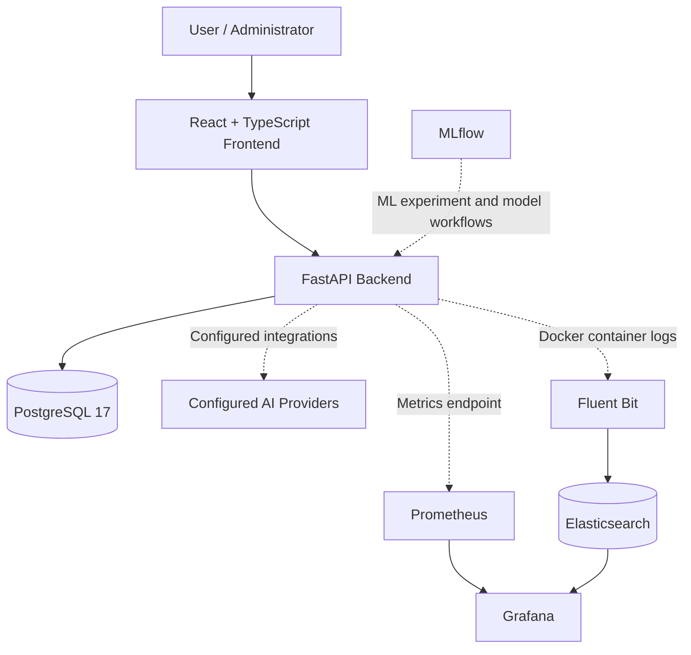

# KBR — Knights of Bizertin Rise

**A web platform for esports and community activities, with administration, event management, AI-assisted capabilities, and an integrated monitoring stack.**

[](https://www.python.org/)
[](https://fastapi.tiangolo.com/)
[](https://react.dev/)
[](https://www.typescriptlang.org/)
[](https://www.postgresql.org/)
[](https://docs.docker.com/compose/)

---

## Table of Contents

- [Overview](#overview)
- [Features](#features)
- [Architecture](#architecture)
- [Technology Stack](#technology-stack)
- [Docker Compose Services](#docker-compose-services)
- [Prerequisites](#prerequisites)
- [Getting Started](#getting-started)
- [Environment Configuration](#environment-configuration)
- [Monitoring and Observability](#monitoring-and-observability)
- [AI and Machine Learning](#ai-and-machine-learning)
- [Project Structure](#project-structure)
- [Development Workflow](#development-workflow)
- [Testing and Quality](#testing-and-quality)
- [Security and Deployment Notes](#security-and-deployment-notes)
- [Roadmap](#roadmap)
- [Contributing](#contributing)
- [License](#license)

## Overview

Knights of Bizertin Rise (KBR) is a web application developed to support esports and community activities in Bizerte, Tunisia.

The project combines a React frontend with a FastAPI backend and PostgreSQL persistence. It includes application areas for authentication, administration, members, events, activities, news, contact submissions, and notifications.

The development environment also includes containerized monitoring and observability components. Prometheus collects backend metrics, Grafana provides dashboards, and Fluent Bit forwards Docker container logs to Elasticsearch for searching and investigation.

The project brings together application development, database management, API integration, containerization, and operational monitoring in one codebase.

## Features

### Web application

- **Authentication:** authentication-related API endpoints and account functionality.
- **Administration:** administrative dashboard and management functionality.
- **Member management:** member data models, schemas, services, and API endpoints.
- **Event management:** event-related application functionality.
- **Activities:** API functionality for activities.
- **News:** news-related application functionality.
- **Contact:** contact-related API functionality.
- **Notifications:** notification-related API functionality.
- **AI-assisted capabilities:** AI provider integration architecture using Gemini and Groq, subject to configuration.

The available functionality is implemented across the frontend and backend. Exact permissions and feature availability depend on the relevant implementation.

### Engineering and operations

- REST API built with FastAPI.
- PostgreSQL persistence.
- Docker Compose-based local infrastructure.
- Backend health endpoint and Prometheus metrics endpoint.
- Grafana dashboards for API performance and resource monitoring.
- Centralized Docker log collection with Fluent Bit and Elasticsearch.
- MLflow service for machine-learning experiment and model-management workflows.
- Automated quality checks through the project's CI workflow.

## Architecture

KBR follows a frontend/backend architecture supported by a relational database and a set of infrastructure services.



### Frontend

The frontend is built with React, TypeScript, and Vite. React Router handles client-side navigation, while TanStack React Query supports API data fetching and server-state management.

### Backend

The backend uses FastAPI and Python. Its API is organized into routers and application layers, separating HTTP endpoints from data models, schemas, and service logic.

### Persistence

PostgreSQL stores application data. SQLAlchemy and Alembic support database interaction and schema migrations.

### Observability

Prometheus collects application metrics, Grafana visualizes metrics and logs, and Fluent Bit collects Docker JSON logs and forwards them to Elasticsearch.

These monitoring services complement the application; they do not replace application-level error handling, security controls, or testing.

## Technology Stack

| Area | Technologies |
|---|---|
| Frontend | React, TypeScript, Vite |
| Routing and data fetching | React Router, TanStack React Query |
| Backend | Python 3.12, FastAPI, Pydantic |
| Database | PostgreSQL 17, SQLAlchemy, Alembic |
| Authentication | JWT-based authentication architecture |
| AI integrations | Gemini and Groq provider architecture |
| Containers | Docker, Docker Compose |
| Metrics | Prometheus |
| Dashboards and log exploration | Grafana |
| Log collection | Fluent Bit |
| Log indexing and search | Elasticsearch 8.17.4 |
| ML experiment tracking | MLflow |
| Version control | Git, GitHub |
| Quality automation | Project CI workflow |

## Docker Compose Services

The local infrastructure is defined in `docker-compose.yml`.

| Service | Image / implementation | Local endpoint | Purpose |
|---|---|---|---|
| `postgres` | PostgreSQL 17 | `localhost:5432` | Application database |
| `backend` | Local backend Docker image | `localhost:8000` | FastAPI API |
| `frontend` | Local frontend Docker image | `localhost:8080` | Web application |
| `mlflow` | MLflow service | `localhost:5000` | ML experiment and model-management interface |
| `prometheus` | Prometheus 3.5.0 | `localhost:9090` | Metrics collection |
| `grafana` | Grafana 12.1.1 | `localhost:3000` | Dashboards and observability |
| `elasticsearch` | Elasticsearch 8.17.4 | `localhost:9200` | Log indexing and search |
| `fluent-bit` | Fluent Bit 3.2.10 | Internal service | Docker log collection and forwarding |

The published ports are bound to `127.0.0.1` in the current Compose configuration, making these interfaces local-development endpoints.

### Persistent volumes

The Compose configuration defines persistent volumes for PostgreSQL, Prometheus, Grafana, Elasticsearch, and Fluent Bit state:

- `kbr_postgres_data`
- `kbr_prometheus_data`
- `kbr_grafana_data`
- `kbr_elasticsearch_data`
- `kbr_fluent_bit_state`

These volumes preserve data and state across container recreation. Removing containers is different from deleting their volumes.

## Prerequisites

Install the following tools before starting the project:

- Git
- Python 3.12
- Node.js and npm
- Docker Desktop with Docker Compose
- A code editor such as Visual Studio Code

For the full containerized environment, Docker Desktop must be running and have sufficient memory allocated for PostgreSQL, Elasticsearch, and the other services.

AI integrations additionally require the credentials for the provider being used.

## Getting Started

### 1. Clone the repository

```bash
git clone https://github.com/Ghaith-Saidani/KBR.git
cd KBR
```

### 2. Configure environment variables

Inspect the repository for `.env.example`, frontend environment templates, and the configuration required by the backend.

If a root `.env.example` exists, copy it to `.env` and fill in the required values:

**PowerShell**

```powershell
Copy-Item .env.example .env
```

**Linux/macOS**

```bash
cp .env.example .env
```

Do not commit `.env` or real credentials to Git.

At minimum, the current Compose configuration requires `GRAFANA_ADMIN_PASSWORD` in the root `.env` file. The backend and database may require additional variables defined by the project's existing configuration.

### 3. Start the infrastructure

Validate the Compose configuration:

```bash
docker compose config --quiet
```

Start the services:

```bash
docker compose up -d --build
```

Check their status:

```bash
docker compose ps
```

Review service logs when troubleshooting:

```bash
docker compose logs --tail=100 backend
docker compose logs --tail=100 frontend
docker compose logs --tail=100 postgres
```

For monitoring components:

```bash
docker compose logs --tail=100 prometheus
docker compose logs --tail=100 grafana
docker compose logs --tail=100 elasticsearch
docker compose logs --tail=100 fluent-bit
```

### 4. Access the application and tools

Once the relevant services are running:

- Frontend: [http://localhost:8080](http://localhost:8080)
- Backend API: [http://localhost:8000](http://localhost:8000)
- FastAPI interactive documentation: [http://localhost:8000/docs](http://localhost:8000/docs)
- Backend health check: [http://localhost:8000/health](http://localhost:8000/health)
- Prometheus metrics: [http://localhost:8000/metrics](http://localhost:8000/metrics)
- Prometheus UI: [http://localhost:9090](http://localhost:9090)
- Grafana: [http://localhost:3000](http://localhost:3000)
- Elasticsearch API: [http://localhost:9200](http://localhost:9200)
- MLflow UI: [http://localhost:5000](http://localhost:5000)

Grafana uses the configured administrator credentials. Some endpoints are intended for local development and may require authentication or additional configuration in other environments.

### 5. Initialize the database

Check the backend configuration and the project's Alembic migrations before initializing the database.

If migrations are configured for the backend container, the usual command is:

```bash
docker compose exec backend alembic upgrade head
```

Run this only if Alembic is installed in the backend image and its configuration points to the intended database. Follow any project-specific initialization instructions if they differ.

### 6. Stop the environment

Stop the services without deleting persistent volumes:

```bash
docker compose down
```

To start them again:

```bash
docker compose up -d
```

**Avoid `docker compose down -v` unless you intentionally want to delete the persistent volumes and their stored data.**

## Environment Configuration

The repository's environment templates and application settings are the source of truth for required variables.

| Variable / setting | Purpose |
|---|---|
| `GRAFANA_ADMIN_PASSWORD` | Required Grafana administrator password in the current Compose configuration |
| Database connection settings | Configure the backend's PostgreSQL connection |
| JWT secret or signing settings | Configure token signing and authentication security |
| AI provider settings | Select and configure the supported AI integration |
| Provider API keys | Supply credentials for the selected AI provider |
| Frontend environment settings | Configure the frontend API base URL if required by the Vite application |

Use the exact variable names expected by the checked-in application settings and environment templates. Do not assume that a variable listed in a generic deployment example is automatically consumed by the application.

Keep secrets out of source code, screenshots, logs, and public repository files.

## Monitoring and Observability

The monitoring stack is designed to make application behavior easier to inspect during development and troubleshooting.

### Prometheus

Prometheus is configured through `monitoring/prometheus.yml`.

The current configuration scrapes:

- Prometheus itself at `prometheus:9090`.
- The KBR backend at `backend:8000`, using the `/metrics` endpoint.

The global scrape and evaluation intervals are 15 seconds, and Prometheus retention is configured for 15 days.

Useful checks:

- Open the Prometheus UI.
- Navigate to **Status → Targets**.
- Confirm that the `prometheus` and `kbr-backend` targets are `UP`.
- Query metrics to inspect request activity and backend performance.

### Grafana

Grafana is available at `http://localhost:3000`.

The existing dashboard is named **KBR - Application Monitoring** and includes these panels:

- **KBR Request Rate:** request activity.
- **KBR HTTP 5xx error rate:** server-error rate.
- **KBR 95th percentile latency:** request latency.
- **KBR Backend memory:** backend memory monitoring.

The Compose environment uses a persistent Grafana data volume. Provisioned data sources are configured under:

`monitoring/grafana/provisioning/datasources/datasources.yml`

The provisioned data sources are:

- `KBR Prometheus (Provisioned)`, using `http://prometheus:9090`.
- `KBR Elasticsearch Logs (Provisioned)`, using `http://elasticsearch:9200`.

The dashboard and its data-source references should be checked whenever Grafana provisioning files are changed.

### Elasticsearch

Elasticsearch indexes Docker logs using time-based indices matching:

`kbr-docker-*`

The Fluent Bit output uses the `kbr-docker` Logstash prefix. Documents include fields such as:

- `@timestamp`
- `container_id`
- `application`
- `log`

Elasticsearch is configured as a single-node instance for local development. Security is disabled in the current Compose configuration, so it must not be exposed to an untrusted network in this configuration.

Check cluster health:

```powershell
Invoke-RestMethod "http://localhost:9200/_cluster/health"
```

Search recent log records:

```powershell
$body = @{
    size = 10
    sort = @(
        @{ "@timestamp" = @{ order = "desc" } }
    )
} | ConvertTo-Json -Depth 5

$response = Invoke-RestMethod `
    -Uri "http://localhost:9200/kbr-docker-*/_search" `
    -Method Post `
    -ContentType "application/json" `
    -Body $body

$response.hits.hits |
    ForEach-Object { $_._source } |
    Format-List
```

### Fluent Bit

Fluent Bit collects Docker JSON log files and forwards records to Elasticsearch.

Configuration files:

- `monitoring/fluent-bit/fluent-bit.conf`
- `monitoring/fluent-bit/docker_metadata.lua`

The Fluent Bit configuration:

1. Tails Docker container log files.
2. Parses Docker log records.
3. Adds the `application=kbr` field.
4. Enriches records with a container ID.
5. Sends records to Elasticsearch.

The tail input maintains state in the `kbr_fluent_bit_state` volume. Fluent Bit runs at `info` log level in the current configuration to avoid excessive internal debug messages.

To inspect the log collector:

```bash
docker compose ps fluent-bit
docker compose logs --tail=100 fluent-bit
```

### Troubleshooting the monitoring stack

| Symptom | What to check |
|---|---|
| Backend target is down | Backend health, port, `/metrics`, and Prometheus target status |
| Grafana data source fails | Provisioning files, service names, URLs, and container network |
| Logs are missing | Fluent Bit logs, Docker log mounts, Elasticsearch health, and index names |
| Container IDs show as unknown | `Tag_Regex`, Lua filter configuration, and the Fluent Bit input tag |
| Grafana configuration does not load | Provisioning mount, YAML syntax, and Grafana startup logs |

## AI and Machine Learning

The project includes an AI integration architecture with Gemini and Groq provider options. Provider availability depends on the configured implementation, API credentials, and the application's environment settings.

The repository also includes an MLflow service for machine-learning experiment and model-management workflows.

A hybrid machine-learning risk-scoring pipeline has been documented in the project. Its scores should be treated as **investigation indicators**, not as proof of malicious activity or as a guarantee of attack detection.

Do not infer model accuracy, production deployment status, or operational performance from the existence of a model, pipeline, or MLflow service alone. Such claims require measured results and supporting evidence.

## Project Structure

The following is a high-level guide to the repository's known application and infrastructure areas. Individual files may evolve during development.

```text
KBR/
├── backend/
│   ├── app/
│   │   ├── api/          # API routers and endpoints
│   │   ├── models/       # Database models
│   │   ├── schemas/      # Request and response schemas
│   │   └── services/     # Application service logic
│   ├── tests/            # Backend tests
│   └── Dockerfile
├── frontend/
│   ├── src/
│   │   ├── components/   # Reusable UI components
│   │   ├── features/     # Feature-specific frontend code
│   │   └── pages/        # Application pages
│   └── ...
├── monitoring/
│   ├── prometheus.yml
│   ├── fluent-bit/
│   │   ├── fluent-bit.conf
│   │   └── docker_metadata.lua
│   └── grafana/
│       └── provisioning/
│           └── datasources/
│               └── datasources.yml
├── data/
│   ├── models/
│   ├── reports/
│   └── mlflow/
├── docker-compose.yml
├── .env.example
└── README.md
```

This tree illustrates the principal areas rather than an exhaustive listing of every file. Consult the repository for the exact current layout and any additional configuration files.

## Development Workflow

### Backend

Create and activate a Python virtual environment if running the backend outside Docker.

**Windows PowerShell**

```powershell
python -m venv .venv
.\.venv\Scripts\Activate.ps1
```

Install the dependencies using the dependency file present in the backend directory, for example:

```powershell
python -m pip install -r backend\requirements.txt
```

Start the backend using the project's configured entry point and environment variables. The Docker Compose configuration remains the reference for containerized execution.

### Frontend

Install dependencies and start the Vite development server from the frontend directory:

```bash
cd frontend
npm install
npm run dev
```

Use the scripts defined in `frontend/package.json` for the exact available development, linting, and build commands.

### Database and infrastructure

Use Docker Compose for the local PostgreSQL, MLflow, Prometheus, Grafana, Elasticsearch, and Fluent Bit services. Keep local environment variables and persisted data separate from version-controlled application code.

## Testing and Quality

The project contains a backend test suite and frontend tests, alongside automated quality checks in its CI workflow.

Run checks using the commands and configuration already defined in the repository. Typical commands, where supported by the current project configuration, include:

```bash
# Backend tests
python -m pytest backend/tests

# Frontend tests
cd frontend
npm test

# Frontend linting and production build
npm run lint
npm run build
```

Some scripts may differ depending on the dependency configuration. Check `pyproject.toml`, the backend dependency files, and `frontend/package.json` before assuming a command is available.

When contributing changes, validate the affected functionality and avoid claiming a test passed unless it was actually executed successfully.

## Security and Deployment Notes

The current configuration is intended for local development and is not, by itself, a production deployment specification.

Before exposing the application or monitoring tools publicly:

- Enable Elasticsearch authentication and transport/HTTP security.
- Configure HTTPS and appropriate reverse-proxy settings.
- Store credentials in a secrets manager or protected deployment environment.
- Replace development JWT secrets and enforce secure token configuration.
- Restrict administrative endpoints and validate authorization rules.
- Review CORS, allowed hosts, and public port bindings.
- Add database backup and recovery procedures.
- Define Elasticsearch index retention and storage limits.
- Review log content for personal information, credentials, and sensitive request data.
- Configure resource limits and health checks appropriate to the deployment.
- Verify monitoring access controls and alerting requirements.

The current Elasticsearch setup disables security, and Fluent Bit forwards Docker logs. These settings should be reviewed before any non-local deployment.

## Roadmap

Potential areas for continued development include:

- Completing automated Grafana dashboard provisioning.
- Improving observability and log filtering.
- Defining Elasticsearch retention and index lifecycle policies.
- Strengthening deployment security and secrets management.
- Improving operational documentation and backup procedures.
- Extending application functionality based on project requirements.

Roadmap items are areas for future work, not claims that those capabilities are already implemented.

## Contributing

Contributions and suggestions are welcome.

1. Fork the repository.
2. Create a feature branch.
3. Make a focused change.
4. Run the relevant tests and quality checks.
5. Submit a pull request describing the change and its validation.

Keep credentials, `.env` files, local databases, generated artifacts, and other sensitive data out of commits.

## License

No license is specified in this README. Check the repository for an existing `LICENSE` file before distributing, modifying, or reusing the project. If no license exists, consider adding one that reflects the project's intended usage and ownership.

---

**Repository:** [github.com/Ghaith-Saidani/KBR](https://github.com/Ghaith-Saidani/KBR)

**Project:** Knights of Bizertin Rise (KBR)